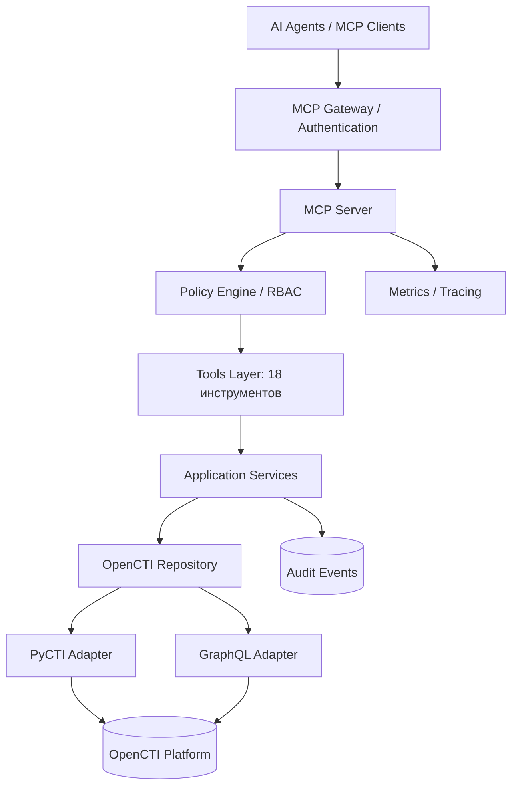

# Функции MCP сервера OpenCTI

Источник: https://chatgpt.com/c/6afd7e92-ea80-83ed-bb38-e0b67e4c6b49

## Запрос

Привет, какие функции ты бы использовал для создания MCP сервера для OpenCTI платформы.

## Ответ

Для создания собственного **MCP-сервера для OpenCTI** я бы предусмотрел не только стандартные CRUD-операции над объектами STIX, но и инструменты, позволяющие ИИ-агенту проводить полноценный Threat Intelligence Analysis, исследовать связи между угрозами, работать с IoC и помогать SOC-аналитикам.

Я бы разделил функциональность на **8 модулей**, с возможностью отдельно включать чтение, изменение данных и расширенные аналитические операции.

Важный момент: у OpenCTI уже существует официальный MCP-интерфейс через XTM One, а также открытый проект urlFiligranHQ/xtm-mcphttps://github.com/FiligranHQ/xtm-mcp для работы с GraphQL. Однако для собственной SOC-инфраструктуры отдельный MCP-сервер может быть полезнее: он позволит добавить специализированные сценарии расследования, интеграции и правила безопасности. citeturn845076view0turn845076view1

## 1\. Поиск и получение информации

(Приоритет P0 — основа MCP)

Это наиболее востребованная группа. ИИ должен уметь находить любую информацию в OpenCTI без знания конкретных STIX ID.

| MCP Tool | Назначение |
|--------|--------|
| `search_entities` | Универсальный поиск по объектам OpenCTI |
| `get_entity` | Полная информация об объекте по ID |
| `list_entities` | Получение объектов с фильтрами, сортировкой и пагинацией |
| `search_indicators` | Поиск индикаторов компрометации |
| `lookup_observable` | Точный поиск IP, домена, URL, хеша или email |
| `get_entity_history` | История изменений объекта |
| `get_entity_statistics` | Статистика по объекту |
| `get_recent_intelligence` | Новые разведывательные данные за выбранный период |

**Примеры запросов к ИИ\:**

> Найди все индикаторы, связанные с APT28, которые были добавлены за последние 30 дней.

> Проверь IP 8.8.8.8 в OpenCTI и расскажи, какие сведения о нём имеются.

> Покажи последние 20 отчётов, связанных с ransomware.

Здесь важно поддерживать `FilterGroup`, поскольку OpenCTI использует этот механизм для сложных фильтров GraphQL. citeturn275479search7turn611120search5

## 2\. Работа с индикаторами и Observables

(Приоритет P0)

Я бы особенно тщательно реализовал этот модуль: индикаторы и наблюдаемые объекты — основа практического использования OpenCTI в SOC.

| MCP Tool | Назначение |
|--------|--------|
| `create_indicator` | Создание индикатора STIX, Sigma, YARA |
| `update_indicator` | Изменение срока действия, confidence, score, описания |
| `create_observable` | Создание IPv4, IPv6, Domain, URL, File Hash и других SCO |
| `update_observable` | Обновление изменяемых атрибутов Observable |
| `promote_observable` | Создание индикатора на основе Observable |
| `bulk_lookup_iocs` | Массовая проверка списка IoC |
| `bulk_import_iocs` | Массовая загрузка индикаторов с дедупликацией |
| `get_indicator_context` | Полный контекст индикатора: угрозы, кампании, источники, связи |
| `get_expiring_indicators` | Поиск индикаторов с истекающим сроком действия |
| `get_iocs_by_label` | Выборка индикаторов и Observables по метке |

Важно соблюдать различие STIX: **Observable — наблюдаемый объект**, а **Indicator — утверждение о потенциально вредоносной активности**, определяемое шаблоном и контекстом. Наличие IP или хеша в базе ещё не означает, что он вредоносный. citeturn275479search28turn275479search27

Для массовых операций я бы дополнительно предусмотрел режим `dry_run`, проверку дубликатов и возврат списка реально созданных, обновлённых и пропущенных объектов.

## 3\. Анализ связей и графа угроз

(Приоритет P0)

Это одна из самых ценных возможностей OpenCTI. Здесь MCP-сервер превращается из интерфейса к базе данных в инструмент расследования.

| MCP Tool | Назначение |
|--------|--------|
| `get_relationships` | Получение входящих и исходящих связей объекта |
| `create_relationship` | Создание STIX-связи между объектами |
| `delete_relationship` | Удаление ошибочной связи |
| `get_related_entities` | Поиск связанных объектов заданного типа |
| `traverse_threat_graph` | Обход графа на заданную глубину |
| `find_common_indicators` | Общие IoC у нескольких угроз или кампаний |
| `find_shared_infrastructure` | Поиск пересекающейся инфраструктуры |
| `get_attack_techniques` | MITRE ATT&amp;CK техники для угрозы или кампании |
| `get_threat_actor_profile` | Сводный профиль Threat Actor / Intrusion Set |

Например\:

> Проанализируй вредоносное ПО PlugX. Найди связанные группировки, инфраструктуру C2, техники MITRE ATT&amp;CK и индикаторы компрометации.

Для этого агент сможет построить цепочку\:

**Malware**

PlugX

Threat Actor

Связанные группировки

Infrastructure

Серверы C2

Indicators

IP, домены, хеши

MITRE ATT&amp;CK

Техники и тактики

`traverse_threat_graph` и `find_shared_infrastructure` — это уже собственные аналитические функции MCP-сервера, которые можно построить поверх стандартных GraphQL-запросов.

При обходе графа необходимо контролировать максимальную глубину, число узлов и типы связей, чтобы не перегружать OpenCTI.

## 4\. Отчёты, инциденты и расследования

| MCP Tool | Назначение |
|--------|--------|
| `search_reports` | Поиск аналитических отчётов |
| `get_report` | Получение отчёта с описанием и связанными объектами |
| `create_report` | Создание нового CTI-отчёта |
| `add_entities_to_report` | Добавление объектов в отчёт |
| `search_cases` | Поиск кейсов расследования |
| `get_case` | Получение содержимого кейса |
| `create_case` | Создание кейса расследования |
| `add_case_note` | Добавление заметки аналитика |
| `get_investigation_context` | Сбор контекста для расследования |

Особенно интересен `get_investigation_context`\. Он должен объединять результаты нескольких запросов и возвращать единую структурированную информацию об угрозе.

Например, при расследовании срабатывания Wazuh можно попросить\:

> Найди информацию об этом SHA256, проверь связанные вредоносные программы и кампании, подготовь краткое заключение для аналитика SOC.

Сервер вернёт доказательства и контекст, на основе которых ИИ сможет подготовить заключение, указав достоверность данных и ссылки на источники.

## 5\. Управление метками, классификацией и обогащением

| MCP Tool | Назначение |
|--------|--------|
| `list_labels` | Получение доступных меток |
| `create_label` | Создание метки |
| `add_label` | Присвоение метки объекту |
| `remove_label` | Удаление метки |
| `bulk_label_entities` | Массовая разметка объектов |
| `propagate_label` | Распространение метки на связанные объекты по правилам |
| `get_markings` | Получение TLP и других ограничений доступа |
| `set_marking` | Изменение маркировки с проверкой прав |
| `list_enrichment_connectors` | Доступные коннекторы обогащения |
| `request_enrichment` | Запуск обогащения объекта |
| `get_enrichment_status` | Проверка результатов обогащения |

Здесь я бы отдельно реализовал `propagate_label`\: например, если у Observable стоит метка `min_obr`, MCP-сервер сможет найти связанные File Observables и проставить такую же метку по установленному правилу.

При этом сервер должен различать File Observable, сущности STIX и вложенные файлы отчётов. Нельзя автоматически считать, что любая связь означает необходимость копирования метки.

## 6\. Импорт, экспорт и управление IoC-фидами

В твоём случае этот модуль особенно интересен из-за использования OpenCTI в качестве источника индикаторов для средств защиты.

| MCP Tool | Назначение |
|--------|--------|
| `import_stix_bundle` | Импорт STIX 2.1 |
| `export_stix_bundle` | Экспорт STIX-объектов со связями |
| `export_indicators` | Экспорт индикаторов по фильтрам |
| `export_observables` | Экспорт IP, URL, доменов и хешей |
| `prepare_ioc_feed` | Подготовка фильтрованного IoC-фида |
| `validate_ioc_feed` | Проверка содержимого перед публикацией |
| `publish_ioc_feed` | Обновление публикуемого фида |
| `get_feed_statistics` | Статистика по опубликованным спискам |

OpenCTI поддерживает экспорт в STIX 2.1 и CSV, а также TAXII 2.1 для распространения разведывательных данных. citeturn611120search25turn275479search17

Я бы сделал следующий сценарий\:

**OpenCTI**

IoC с меткой min\_obr

**MCP-сервер**

Фильтрация, проверка, дедупликация

**OPNsense**

URL Table Aliases

**UserGate**

Обновляемые списки

Агент сможет выполнить запрос\:

> Подготовь список всех действующих IP-индикаторов с меткой min\_obr и оценкой выше 70 для публикации на межсетевых экранах.

Важно: `prepare_ioc_feed` только готовит результат. Фактическая публикация должна быть отдельной операцией с проверкой срока действия, типа индикатора, TLP, разрешённых адресов и списка исключений. Оценка выше 70 в примере — пользовательский порог, а не универсальный критерий вредоносности.

## 7\. Расширенная аналитика Threat Intelligence

Эти инструменты я бы реализовал собственными алгоритмами поверх OpenCTI.

| MCP Tool | Назначение |
|--------|--------|
| `analyze_ioc` | Комплексная оценка IoC с указанием оснований |
| `correlate_iocs` | Анализ взаимосвязей группы индикаторов |
| `compare_threat_actors` | Сравнение группировок по TTP и инфраструктуре |
| `analyze_campaign` | Анализ кампании, её участников и инфраструктуры |
| `find_ioc_overlaps` | Пересечения индикаторов между отчётами и кампаниями |
| `detect_intelligence_gaps` | Поиск недостатка данных об угрозах |
| `generate_threat_summary` | Формирование краткой аналитической сводки |
| `analyze_threat_trends` | Анализ изменения активности угроз во времени |

Например\:

> Проанализируй последние отчёты о ransomware. Определи наиболее часто упоминаемые техники MITRE ATT&amp;CK, общие инструменты и повторно используемую инфраструктуру.

Здесь OpenCTI выступает источником фактов, а MCP-сервер собирает нужные данные. Выводы формирует аналитическая логика агента, причём каждый вывод должен иметь подтверждение из полученных объектов.

## 8\. Управление платформой и диагностика

Этот модуль лучше выделить отдельно, с ограниченным доступом.

| MCP Tool | Назначение |
|--------|--------|
| `get_platform_info` | Версия OpenCTI, основные возможности API |
| `get_platform_health` | Проверка доступности платформы |
| `list_connectors` | Перечень коннекторов |
| `get_connector_status` | Состояние коннектора |
| `get_connector_errors` | Последние ошибки выполнения, если доступны |
| `get_data_quality_stats` | Статистика качества CTI-данных |
| `get_duplicate_candidates` | Поиск потенциальных дубликатов |
| `get_ingestion_statistics` | Объём и динамика поступления данных |

Этот модуль не входит в набор административных функций официального MCP через XTM One. В собственном сервере его можно реализовать с отдельными полномочиями и ограничением доступных операций. citeturn845076view0

---

## Какую архитектуру я бы выбрал

**MCP-клиенты / AI-агенты**

ChatGPT, Claude, Cursor, свои сервисы

**MCP Server**

Python MCP SDK · Streamable HTTP

---

**OpenCTI Client Layer**

PyCTI + GraphQL API

**OpenCTI Platform**

STIX 2.1 · Knowledge Graph

Для реализации я бы использовал Python, официальный `pycti` и Python MCP SDK. Для удалённого подключения — Streamable HTTP, для локальных клиентов — stdio. citeturn845076view5turn275479search0

При этом есть важный технический момент: **версия PyCTI должна соответствовать установленной версии OpenCTI**\. Иначе можно столкнуться с ошибками GraphQL, связанными с отсутствующими полями. Например, ошибки вида `Cannot query field "customFieldValues"` могут быть следствием несовместимости схем. citeturn845076view4

Для production я бы предусмотрел раздельные полномочия чтения и записи, проверку TLP и RBAC, обязательный аудит изменений, лимиты GraphQL-запросов и подтверждение потенциально разрушительных операций. Произвольный `graphql_query` лучше не предоставлять агентам с правами на запись.

## Что реализовывать в первую очередь

Я бы не начинал сразу с 60–80 инструментов. Лучше сделать качественное ядро, которое покрывает наиболее полезные пользовательские сценарии.

**Конструктор набора MCP-инструментов** (инструментов)

[Подготовить спецификацию выбранных модулей]

**Мой основной выбор для первого релиза — 13 инструментов** из первых трёх групп. Они позволят агенту искать данные, исследовать связи, проверять IoC и готовить выгрузки для средств защиты без риска непреднамеренного изменения CTI-базы.

Вторым этапом я бы добавил изменение объектов, обогащение и аналитические функции. Так получится не просто универсальная оболочка над OpenCTI API, а действительно полезный MCP-сервер для задач SOC и Threat Intelligence.

## Запрос

Подготовь подробную архитектуру и спецификацию MCP-сервера OpenCTI для следующих модулей и инструментов: Поиск и CTI: search_entities, get_entity, lookup_observable, search_indicators, get_recent_intelligence; Граф и расследования: get_relationships, get_related_entities, traverse_threat_graph, get_investigation_context; IoC и экспорт: get_iocs_by_label, bulk_lookup_iocs, export_indicators, prepare_ioc_feed; Изменение данных: create_indicator, create_observable, create_relationship, add_label, bulk_label_entities. Нужны схемы параметров и ответов, структура Python-проекта, безопасность, реализация через PyCTI и GraphQL, тесты и этапы разработки.

## Ответ

# Техническое задание и архитектура MCP-сервера для OpenCTI

Проект: OpenCTI MCP Server · Версия спецификации 1.0 · 18 MCP Tools · Python / PyCTI / GraphQL

## 1\. Цель проекта

Разработать собственный MCP-сервер, предоставляющий ИИ-агентам стандартизированный интерфейс для взаимодействия с платформой OpenCTI.

Сервер должен обеспечивать\:

- Поиск и получение Threat Intelligence (CTI).
- Анализ STIX-объектов и их взаимосвязей.
- Поиск IoC и получение контекста для расследований.
- Пакетную обработку индикаторов.
- Подготовку и экспорт IoC для внешних средств защиты.
- Создание STIX Indicator, Cyber Observable и Relationship.
- Управление метками объектов.
- Контролируемый доступ с разграничением операций чтения и записи.

**Главный архитектурный принцип\:** MCP-сервер не должен быть простым прокси, позволяющим ИИ выполнять произвольные GraphQL-запросы. Он должен предоставлять типизированные инструменты с контролируемыми параметрами, проверкой прав и предсказуемыми результатами.

## 2\. Технологический стек

| Компонент | Технология | Назначение |
|--------|--------|--------|
| Язык | Python 3.12+ | Основная разработка |
| MCP | Официальный Python MCP SDK | Регистрация и выполнение инструментов |
| API OpenCTI | PyCTI | Основные операции с объектами |
| Расширенные запросы | GraphQL | Выборка связей, фильтрация, пагинация |
| Модели данных | Pydantic v2 | Валидация входных и выходных данных |
| HTTP-клиент | httpx | Асинхронные служебные запросы, если необходимы |
| Транспорт | Streamable HTTP / stdio | Удалённое и локальное подключение |
| Авторизация | OAuth 2.1 / JWT | Аутентификация MCP-клиентов |
| Конфигурация | pydantic-settings | Переменные окружения |
| Тестирование | pytest, pytest-asyncio, respx | Модульные и интеграционные тесты |
| Качество кода | Ruff, mypy | Линтинг и статическая проверка |
| Метрики | Prometheus / OpenTelemetry | Мониторинг и трассировка |
| Контейнеризация | Docker | Развёртывание |

Официальная библиотека PyCTI предоставляет методы работы с сущностями OpenCTI и доступ к GraphQL. Документация актуальных версий также подтверждает использование `FilterGroup` и курсорной пагинации. citeturn732044search1turn732044search0turn732044search13

Точную совместимость версий OpenCTI, PyCTI и MCP SDK нужно закрепить в lock-файле после проверки на целевом экземпляре платформы.

## 3\. Общая архитектура



### 3.1. Разделение на слои

**Transport Layer**

Обрабатывает подключение MCP-клиентов, регистрацию инструментов, получение параметров и выдачу результатов.

**Security Layer**

Проверяет пользователя, область полномочий, разрешённые операции, маркировку данных и ограничения запросов.

**Tools Layer**

Содержит 18 публичных инструментов. Отвечает за MCP-контракты, но не должен содержать сложную бизнес-логику.

**Service Layer**

Реализует прикладные сценарии: поиск IoC, анализ графа, подготовку фидов, пакетную разметку, создание объектов.

**Repository Layer**

Предоставляет абстракции над OpenCTI API и скрывает конкретные GraphQL-запросы.

**Infrastructure Layer**

Содержит PyCTI-клиент, GraphQL-адаптер, настройки, логирование и интеграции.

Такое разделение позволяет обновлять GraphQL-запросы при изменении схемы OpenCTI, не переписывая интерфейсы MCP-инструментов.

### 3.2. Границы ответственности

Я предлагаю следующие правила\:

1. **PyCTI** использовать для стандартных CRUD-операций.
2. **GraphQL** использовать для оптимизированных выборок, сложных фильтров и пакетного получения связей.
3. **Service Layer** реализует дедупликацию, обход графа, бизнес-правила, расчёт статистики.
4. **MCP Tools** выполняют только валидацию, авторизацию и вызов сервисов.
5. **OpenCTI** остаётся источником истины для CTI-объектов. MCP-сервер не создаёт собственную независимую базу Threat Intelligence.

Для первой версии постоянная база данных MCP-серверу не требуется. При необходимости можно позднее добавить Redis для кратковременного кеширования и PostgreSQL для долговременного аудита и управления заданиями.

---

# 4\. Спецификация MCP Tools

Всего проект содержит 18 инструментов, распределённых по четырём функциональным модулям.

## 4.1. Общие правила контрактов

Все инструменты должны использовать единые соглашения.

| Параметр | Правило |
|--------|--------|
| `limit` | По умолчанию 25, максимум 100 |
| `cursor` | Непрозрачный курсор для постраничной выборки |
| `id` | Внутренний OpenCTI ID или STIX ID, если адаптер поддерживает его разрешение |
| `created_after` | Дата ISO 8601 с часовым поясом |
| `types` | Массив поддерживаемых типов объектов |
| `labels` | Список меток для фильтрации |
| `confidence` | Уверенность в достоверности информации, 0–100 |
| `score` | Оценка индикатора OpenCTI, 0–100 |
| `dry_run` | Предварительная проверка без изменения данных |
| `request_id` | Идентификатор вызова для трассировки |

Даты должны передаваться в формате RFC 3339 / ISO 8601, например `2026-11-18T10:00:00Z`\.

Для всех операций чтения используется единый формат\:

```json
{
  "success": true,
  "data": {},
  "pagination": {
    "limit": 25,
    "end_cursor": null,
    "has_next_page": false
  },
  "meta": {
    "request_id": "req-example",
    "source": "opencti",
    "truncated": false,
    "warnings": []
  }
}
```

Для ошибок\:

```json
{
  "success": false,
  "error": {
    "code": "ENTITY_NOT_FOUND",
    "message": "Объект не найден или недоступен",
    "retryable": false,
    "details": {}
  },
  "meta": {
    "request_id": "req-example"
  }
}
```

Предлагаемые коды ошибок: `VALIDATION_ERROR`, `UNAUTHORIZED`, `FORBIDDEN`, `ENTITY_NOT_FOUND`, `CONFLICT`, `RATE_LIMITED`, `UPSTREAM_TIMEOUT`, `UPSTREAM_ERROR`, `LIMIT_EXCEEDED`, `UNSUPPORTED_OPERATION`, `PARTIAL_FAILURE`\.

`request_id`, субъект доступа и эффективные полномочия формируются сервером, а не передаются ИИ в качестве доверенных параметров.

Все схемы ниже — **публичные контракты проектируемого MCP-сервера**, а не названия нативных аргументов PyCTI.

## 4.2. Модуль Search &amp; CTI

### Tool 1 — `search_entities`

Универсальный поиск STIX-объектов.

| Параметр | Тип | Описание |
|--------|--------|--------|
| `query` | string, обязательный | Поисковая строка, 1–512 символов |
| `types` | string\[\] | Типы: Malware, Threat-Actor, Campaign, Indicator и другие |
| `labels` | string\[\] | Фильтр по меткам |
| `created_after` | datetime | Нижняя граница даты добавления |
| `limit` | integer | Размер выборки |
| `cursor` | string/null | Продолжение предыдущей выборки |
| `sort_by` | enum | `created_at`, `updated_at`, `name` |
| `sort_order` | enum | `asc`, `desc` |

**Ответ\:** `items: EntitySummary[]`, `pagination`\.

`EntitySummary` содержит\:

```json
{
  "id": "opencti-internal-id",
  "stix_id": "malware--00000000-0000-4000-8000-000000000001",
  "entity_type": "Malware",
  "name": "Example Malware",
  "description": "Описание объекта",
  "confidence": 80,
  "labels": ["ransomware"],
  "markings": ["TLP:GREEN"],
  "created_at": "2026-11-18T09:00:00Z"
}
```

**Реализация\:** `stix_core_object.list()` с маршрутизацией по типам. Для специальных семейств объектов допускается вызов специализированных PyCTI-клиентов.

### Tool 2 — `get_entity`

Получение подробной информации об объекте.

| Параметр | Тип | Описание |
|--------|--------|--------|
| `id` | string, обязательный | ID объекта |
| `include_labels` | boolean | Включить метки, по умолчанию true |
| `include_markings` | boolean | Включить маркировки, по умолчанию true |
| `include_external_references` | boolean | Включить источники |
| `include_description` | boolean | Полное описание |
| `include_relationships` | boolean | Включить краткую выборку связей |
| `relationships_limit` | integer | Максимум 25 связей |

**Ответ\:** `entity: EntityDetail`, при необходимости `relationships: RelationshipSummary[]`\.

Дополнительные поля `EntityDetail`\: `aliases`, `created_by`, `first_seen`, `last_seen`, `modified`, `revoked`, `external_references`, `stix_properties`\.

Если объект представляет собой Indicator, возвращаются `pattern`, `pattern_type`, `valid_from`, `valid_until`, `score`\.

Реализация использует специализированный `read()` соответствующего типа.

### Tool 3 — `lookup_observable`

Точный поиск Cyber Observable по значению.

| Параметр | Тип | Описание |
|--------|--------|--------|
| `value` | string, обязательный | Значение IP, домена, URL, хеша |
| `observable_type` | enum/null | `IPv4-Addr`, `IPv6-Addr`, `Domain-Name`, `Url`, `File` |
| `hash_algorithm` | enum/null | MD5, SHA-1, SHA-256 |
| `include_indicators` | boolean | Найти связанные индикаторы |
| `include_context` | boolean | Получить связанный контекст |
| `limit` | integer | Максимум результатов |

**Ответ\:**

```json
{
  "data": {
    "query": {
      "type": "IPv4-Addr",
      "value": "203.0.113.25"
    },
    "found": true,
    "observables": [
      {
        "id": "observable-id",
        "type": "IPv4-Addr",
        "value": "203.0.113.25",
        "score": 70,
        "labels": ["suspicious"]
      }
    ],
    "indicators": [],
    "matches": 1
  }
}
```

Значения примера условные.

Особенности реализации\:

- IP нормализуются через `ipaddress`\.
- Домены — через IDNA с учётом регистра по правилам DNS.
- Хеши проверяются по длине и шестнадцатеричному формату.
- URL не приводятся безусловно к нижнему регистру.
- Точный поиск не должен подменяться поиском по частичному совпадению.

При неопределённом типе допускается поиск по нескольким совместимым типам. Для File Hash необходимо использовать конкретное поле хеша.

### Tool 4 — `search_indicators`

Поиск STIX Indicator с расширенными фильтрами.

| Параметр | Тип | Описание |
|--------|--------|--------|
| `query` | string/null | Название или фрагмент pattern |
| `pattern_type` | enum/null | `stix`, `sigma`, `yara`, `snort`, `suricata` — при поддержке экземпляром |
| `observable_types` | string\[\] | Основные типы Observables |
| `min_score` | integer | 0–100 |
| `min_confidence` | integer | 0–100 |
| `labels` | string\[\] | Метки |
| `active_only` | boolean | Только действующие индикаторы |
| `exclude_revoked` | boolean | Исключить отозванные |
| `limit` / `cursor` | integer / string | Пагинация |

**Ответ\:** `items: IndicatorSummary[]`, `pagination`\.

`IndicatorSummary`\: `id`, `name`, `pattern`, `pattern_type`, `score`, `confidence`, `valid_from`, `valid_until`, `revoked`, `labels`, `markings`\.

Под `active_only` понимается проверка `revoked=false`, наступления `valid_from`, окончания `valid_until`, а также применимых к экземпляру правил жизненного цикла. Это не универсальное встроенное булево поле STIX. OpenCTI может пересчитывать сроки действия посредством decay rules. citeturn732044search7

### Tool 5 — `get_recent_intelligence`

Получение новых или изменённых CTI-данных.

| Параметр | Тип | Описание |
|--------|--------|--------|
| `since` | datetime, обязательный | Начало временного окна |
| `until` | datetime/null | Конец окна, по умолчанию текущее время |
| `types` | string\[\] | Типы сущностей |
| `date_field` | enum | `created_at`, `updated_at` |
| `labels` | string\[\] | Фильтрация |
| `limit` / `cursor` | integer / string | Пагинация |

**Ответ\:** `items: EntitySummary[]`, `pagination`, `window`\.

Рекомендуемые значения по умолчанию: `date_field=created_at`, окно 24 часа.

Следует различать платформенное время добавления (`created_at`\) и дату создания STIX-объекта (`created`\). Для поиска новых поступлений в OpenCTI используется первое.

---

## 4.3. Модуль Graph &amp; Investigation

### Tool 6 — `get_relationships`

Получение связей выбранного STIX-объекта.

| Параметр | Тип | Описание |
|--------|--------|--------|
| `entity_id` | string, обязательный | ID исходного объекта |
| `direction` | enum | `incoming`, `outgoing`, `both` |
| `relationship_types` | string\[\] | Например, `indicates`, `uses`, `attributed-to` |
| `target_types` | string\[\] | Типы связанных сущностей |
| `include_endpoints` | boolean | Включить сведения об обоих узлах |
| `relationship_kinds` | string\[\] | `stix_core`, `sighting`, `reference` |
| `limit` / `cursor` | integer / string | Пагинация |

**Ответ\:** `items: RelationshipSummary[]`, `pagination`\.

```json
{
  "id": "relationship-id",
  "relationship_type": "uses",
  "kind": "stix_core",
  "source": {
    "id": "source-id",
    "type": "Intrusion-Set",
    "name": "Example Group"
  },
  "target": {
    "id": "target-id",
    "type": "Malware",
    "name": "Example Malware"
  },
  "confidence": 85,
  "markings": ["TLP:GREEN"]
}
```

Базовая реализация — `stix_core_relationship.list()`\. Для sighting и внутренних ссылочных отношений используются отдельные адаптеры: эти типы нельзя считать обычными STIX Core Relationships.

### Tool 7 — `get_related_entities`

Получение связанных сущностей, без необходимости вручную обрабатывать Relationship.

| Параметр | Тип | Описание |
|--------|--------|--------|
| `entity_id` | string, обязательный | Исходный объект |
| `entity_types` | string\[\] | Допустимые типы соседей |
| `relationship_types` | string\[\] | Допустимые типы связей |
| `direction` | enum | Направление |
| `include_relationships` | boolean | Вернуть подтверждающие связи |
| `limit` / `cursor` | integer / string | Пагинация |

**Ответ\:** `items: RelatedEntity[]`, где каждый элемент содержит `entity: EntitySummary`, `via_relationships: RelationshipSummary[]`\.

Если объект связан с исходным несколькими отношениями, сущность не дублируется: отношения объединяются внутри `via_relationships`\.

### Tool 8 — `traverse_threat_graph`

Контролируемый обход графа угроз.

| Параметр | Тип | Описание |
|--------|--------|--------|
| `start_entity_id` | string, обязательный | Начальный узел |
| `max_depth` | integer | 1–3, по умолчанию 2 |
| `max_nodes` | integer | 1–200, по умолчанию 100 |
| `max_edges` | integer | 1–500 |
| `relationship_types` | string\[\] | Разрешённые связи |
| `entity_types` | string\[\] | Разрешённые типы соседей |
| `direction` | enum | `incoming`, `outgoing`, `both` |
| `include_sightings` | boolean | Учитывать наблюдения |
| `include_references` | boolean | Учитывать ссылочные отношения |

**Ответ\:** `graph: ThreatGraph`, `statistics`, `truncated`, `truncation_reason`\.

```json
{
  "data": {
    "graph": {
      "nodes": [
        {
          "id": "node-1",
          "type": "Malware",
          "name": "Example Malware",
          "depth": 0
        }
      ],
      "edges": []
    },
    "statistics": {
      "nodes_count": 1,
      "edges_count": 0,
      "max_depth_reached": 0
    },
    "truncated": false,
    "truncation_reason": null
  }
}
```

Рекомендуемый алгоритм — BFS, то есть обход графа в ширину. Он позволяет контролировать глубину и лучше подходит для получения ближайшего контекста.

Необходимо хранить множество посещённых узлов и отдельно уникальные ID связей. Ограничение количества результатов обязательно должно действовать на уровне запросов к OpenCTI, а не только после получения данных.

Для крупных графов предпочтительно возвращать усечённый результат с `truncated=true`, а не выполнять неограниченную рекурсию.

### Tool 9 — `get_investigation_context`

Сбор контекста для аналитика SOC.

| Параметр | Тип | Описание |
|--------|--------|--------|
| `entity_id` | string/null | Известный объект |
| `observable_value` | string/null | IoC для поиска |
| `observable_type` | string/null | Тип IoC |
| `include_reports` | boolean | Связанные отчёты |
| `include_techniques` | boolean | MITRE ATT&amp;CK |
| `include_infrastructure` | boolean | Связанная инфраструктура |
| `include_threat_actors` | boolean | Субъекты угроз |
| `max_depth` | integer | 1–2 |
| `max_items_per_section` | integer | Максимум 25 |

Обязательно должен быть указан `entity_id` либо `observable_value`\.

**Ответ\:**

```json
{
  "data": {
    "subject": {
      "id": "observable-id",
      "type": "IPv4-Addr",
      "value": "203.0.113.25"
    },
    "associated_indicators": [],
    "malware": [],
    "threat_actors": [],
    "campaigns": [],
    "infrastructure": [],
    "attack_patterns": [],
    "reports": [],
    "evidence": [],
    "limitations": [],
    "statistics": {
      "relationships_examined": 0,
      "reports_found": 0
    }
  }
}
```

Этот инструмент не должен самостоятельно утверждать, что IoC однозначно принадлежит конкретной группировке. Он возвращает факты, свидетельства, их источники и степень уверенности. Аналитическую интерпретацию выполняет вызывающий агент.

---

## 4.4. Модуль IoC &amp; Export

### Tool 10 — `get_iocs_by_label`

Получение IoC с заданной меткой.

| Параметр | Тип | Описание |
|--------|--------|--------|
| `label` | string, обязательный | Название метки |
| `object_kinds` | enum\[\] | `indicator`, `observable` |
| `observable_types` | string\[\] | IP, Domain, URL, File и другие |
| `min_score` | integer/null | Минимальная оценка |
| `min_confidence` | integer/null | Минимальная достоверность |
| `active_only` | boolean | Учитывать действительность индикатора |
| `limit` / `cursor` | integer / string | Пагинация |

**Ответ\:** `items: IOCRecord[]`, `pagination`\.

`IOCRecord` содержит\:

`id`, `kind`, `observable_type`, `value`, `pattern`, `score`, `confidence`, `labels`, `valid_until`, `revoked`, `markings`\.

Для Observable без связанного Indicator `active_only` не может оцениваться по правилам действительности индикатора. Такая запись возвращается со статусом `not_applicable` или исключается согласно явной политике запроса.

### Tool 11 — `bulk_lookup_iocs`

Массовая проверка индикаторов компрометации.

| Параметр | Тип | Описание |
|--------|--------|--------|
| `items` | IOCInput\[\] | От 1 до 100 элементов |
| `include_indicators` | boolean | Найти связанные Indicators |
| `include_context` | boolean | Добавить краткий контекст |
| `max_matches_per_ioc` | integer | По умолчанию 10 |

Формат элемента\:

```json
{
  "type": "IPv4-Addr",
  "value": "203.0.113.25"
}
```

Для файлового хеша типом является `File`, а дополнительным полем — `hash_algorithm`\.

**Ответ\:** `results: IOCLookupResult[]`, `statistics`\.

Каждый элемент содержит исходное значение, результат нормализации, `found`, найденные Observables/Indicators и индивидуальную ошибку при её наличии.

Сервер должен сохранять соответствие между входным элементом и результатом даже при дубликатах.

### Tool 12 — `export_indicators`

Экспорт индикаторов в машиночитаемом формате.

| Параметр | Тип | Описание |
|--------|--------|--------|
| `format` | enum | `json`, `csv`, `stix2` |
| `labels` | string\[\] | Метки |
| `observable_types` | string\[\] | Типы |
| `min_score` | integer/null | Минимальная оценка |
| `active_only` | boolean | Только действующие |
| `created_after` | datetime/null | Временной фильтр |
| `limit` / `cursor` | integer / string | Пагинация |
| `include_relationships` | boolean | Связанные STIX-отношения |

**Ответ\:** `export: ExportResult`, `pagination`\.

`ExportResult`\:

- `format` — формат.
- `content` — содержимое небольшой выгрузки.
- `mime_type` — MIME-тип.
- `count` — число экспортированных записей.
- `sha256` — контрольная сумма результата.
- `truncated` — признак неполной выборки.

Для больших экспортов следует использовать MCP Resources или отдельный авторизованный endpoint с ограниченным временем действия ссылки. Не нужно возвращать сотни мегабайт через один ответ инструмента.


> Здесь заканчивается доступный фрагмент ответа. Полный ответ превышает лимит чтения инструмента.

